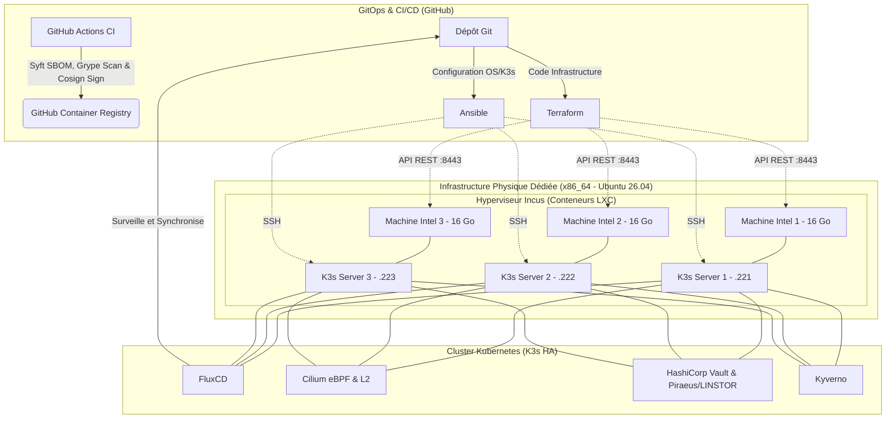

# 🛡️ Laboratoire DevSecOps & Ingénierie de Plateforme (Bare-Metal x86_64)

Bienvenue sur le dépôt de mon infrastructure "Homelab" orientée DevSecOps. L'objectif de ce projet est de concevoir, déployer et maintenir un cluster Kubernetes en Haute Disponibilité (HA) respectant les standards de l'industrie et les principes du "Zero Trust". Ce dépôt centralise l'Infrastructure as Code (IaC), la configuration système et les manifestes applicatifs.

## 🎯 Objectifs du Projet

- **Haute Disponibilité Matérielle Symétrique :** Déploiement d'un plan de contrôle K3s avec quorum `etcd` réparti sur 3 machines physiques dédiées et identiques (3 × 16 Go RAM).
    
- **Automatisation de Bout en Bout :** Séparation stricte des responsabilités (Terraform/OpenTofu, Ansible, FluxCD).
    
- **Sécurité "Shift-Left" et "Shield-Right" :** Signature GPG obligatoire des commits (sans bypass), audit statique IaC (Checkov, Gitleaks), génération SBOM et scan CVE découplés (Anchore Syft & Grype), signature Keyless (Cosign OIDC) et validation à l'admission (Kyverno).
    
- **GitOps Zero-Trust :** Ce dépôt (lui-même géré par Terraform/OpenTofu via des *GitHub Rulesets*) agit comme l'unique source de vérité. FluxCD vérifie mathématiquement la signature GPG du commit `HEAD` dans le cluster avant d'appliquer tout changement.
    

## 🛠️ Pile Technologique (Tech Stack)

- **Matériel & Hyperviseur :** 3 Nœuds physiques Intel dédiés (x86_64, 48 Go RAM total) / Ubuntu 26.04 LTS / Conteneurs système Incus.
    
- **Orchestration :** Kubernetes (K3s).
    
- **Réseau & Observabilité :** Cilium (eBPF) avec L2 Announcements / Ingress Traefik.
    
- **Stockage Distribué :** Piraeus Operator (LINSTOR / DRBD 9 en espace noyau — Réplication 3x).
    
- **Automatisation (IaC) :** Terraform/OpenTofu (avec chiffrement natif du `.tfstate` en AES-GCM) & Ansible.
    
- **GitOps :** FluxCD.
    
- **Gestion des Secrets :** Mozilla SOPS (Age) & HashiCorp Vault.
    
- **Sécurité de la Chaîne d'Approvisionnement :** Signature Git OpenPGP (GPG), Gitleaks, Checkov, Anchore (Syft & Grype), Sigstore (Cosign), Kyverno.
    

## 📐 Architecture Logique et Réseau



---

## 📂 Structure du Dépôt

```text
homelab-devsecops/
├── .devcontainer/                  # Boîte à outils immuable Ubuntu 26.04 ( binaires vérifiés par SHA-256 )
├── .github/workflows/              # Pipelines CI Shift-Left (Gitleaks, OpenTofu/TFLint, Ansible-Lint, Checkov, Syft/Grype/Cosign)
├── cluster/                        # État désiré Kubernetes synchronisé par FluxCD (GitOps)
│   ├── clusters/homelab/           # Point d'entrée FluxCD (vérification GPG sur HEAD + déchiffrement SOPS/Age)
│   ├── infrastructure/             # Contrôleurs (HelmRepositories/HelmReleases) et configurations (Pool L2 Cilium, PKI, etc.)
│   └── apps/                       # Charges de travail applicatives (Namespace verrouillé PSA Restricted)
├── docs/                           # Runbook Jour 0 et Architecture Decision Records (ADR)
├── infrastructure/
│   ├── ansible/                    # Niveau 0 (Hôtes Ubuntu 26.04, DRBD 9 DKMS, Incus 7.5) & Niveau 2 (Quorum K3s HA + Cilium)
│   └── terraform/                  # Niveau 1 : Provisionnement API Incus et gouvernance GitHub Rulesets (State chiffré AES-GCM)
└── scripts/                        # Utilitaires d'automatisation du cycle de vie des clés GPG
```

---

## 📚 Documentation & Décisions Architecturales (ADR)

- 🚀 **[Guide d'amorçage (Jour 0) et Runbook d'initialisation](docs/bootstrap-guide.md)**

| Référence | Décision Architecturale | Statut |
| :--- | :--- | :--- |
| **[ADR-0001](docs/Architecture%20Decision%20Records/ADR-0001-choix-architecture-materielle.md)** | Choix de l'architecture matérielle x86_64 dédiée (3 × 16 Go) et séparation des responsabilités | Accepté |
| **[ADR-0002](docs/Architecture%20Decision%20Records/ADR-0002-choix-hyperviseur.md)** | Sélection de l'hyperviseur léger **Incus 7.5** (conteneurs système LXC) | Accepté |
| **[ADR-0003](docs/Architecture%20Decision%20Records/ADR-0003-strategie-automatisation.md)** | Stratégie d'automatisation découplée (**Ansible**, **OpenTofu** avec chiffrement d'état AES-GCM, **FluxCD**) | Accepté |
| **[ADR-0004](docs/Architecture%20Decision%20Records/ADR-0004-reseau-cni-et-loadbalancing-cilium.md)** | Remplacement du CNI et de `kube-proxy` par **Cilium eBPF** et équilibrage de charge **L2 Announcements** | Accepté |
| **[ADR-0005](docs/Architecture%20Decision%20Records/ADR-0005-pki-et-certificats-dns01.md)** | Gestion automatisée de la PKI en environnement privé (**Cert-Manager** + Let's Encrypt **DNS-01 Cloudflare**) | Accepté |
| **[ADR-0006](docs/Architecture%20Decision%20Records/ADR-0006-gestion-dynamique-secrets-vault.md)** | Gestion dynamique des secrets d'entreprise (**HashiCorp Vault** Raft HA & **External Secrets Operator**) | Accepté |
| **[ADR-0007](docs/Architecture%20Decision%20Records/ADR-0007-securite-chaine-approvisionnement.md)** | Sécurité de la Supply Chain (**GPG**, **Gitleaks**, **Checkov**, **Anchore Syft/Grype**, **Cosign**, **Kyverno**) | Accepté |
| **[ADR-0008](docs/Architecture%20Decision%20Records/ADR-0008-stockage-distribue.md)** | Système de stockage distribué en espace noyau (**Piraeus Operator v2 / LINSTOR & DRBD 9**) | Accepté |
| **[ADR-0009](docs/Architecture%20Decision%20Records/ADR-0009-environnement-administration.md)** | Environnement d'administration isolé, reproductible et vérifié par SHA-256 (**DevContainer**) | Accepté |

