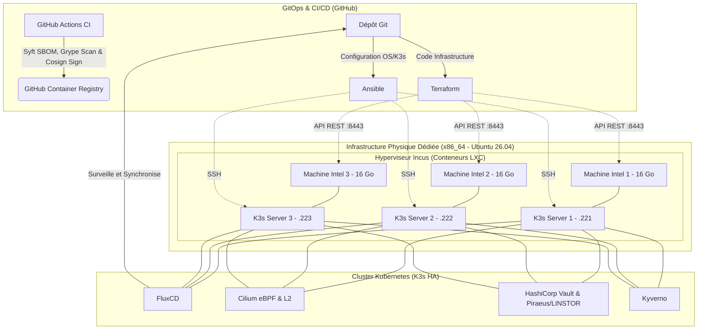

# 🛡️ Laboratoire DevSecOps & Ingénierie de Plateforme (Bare-Metal x86_64)

Bienvenue sur le dépôt de mon infrastructure "Homelab" orientée DevSecOps. L'objectif de ce projet est de concevoir, déployer et maintenir un cluster Kubernetes en Haute Disponibilité (HA) respectant les standards de l'industrie et les principes du "Zero Trust". Ce dépôt centralise l'Infrastructure as Code (IaC), la configuration système et les manifestes applicatifs.

## 🎯 Objectifs du Projet

- **Haute Disponibilité Matérielle Symétrique :** Déploiement d'un plan de contrôle K3s avec quorum `etcd` réparti sur 3 machines physiques dédiées et identiques (3 × 16 Go RAM).
    
- **Automatisation de Bout en Bout :** Séparation stricte des responsabilités (Terraform/OpenTofu, Ansible, FluxCD).
    
- **Sécurité "Shift-Left" et "Shield-Right" :** Signature GPG obligatoire des commits (sans bypass), audit statique IaC (Checkov, Gitleaks), génération SBOM et scan CVE découplés (Anchore Syft & Grype), signature Keyless (Cosign OIDC) et validation à l'admission (Kyverno).
    
- **GitOps Zero-Trust :** Ce dépôt (lui-même géré par Terraform/OpenTofu via des *GitHub Rulesets*) agit comme l'unique source de vérité. FluxCD vérifie mathématiquement la signature GPG du commit `HEAD` dans le cluster avant d'appliquer tout changement.
    

## 🛠️ Pile Technologique (Tech Stack)

- **Matériel & Hyperviseur :** 3 Nœuds physiques Intel dédiés (x86_64, 48 Go RAM total) / Ubuntu 26.04 LTS / Conteneurs système Incus.
    
- **Orchestration :** Kubernetes (K3s).
    
- **Réseau & Observabilité :** Cilium (eBPF) avec L2 Announcements / Ingress Traefik.
    
- **Stockage Distribué :** Piraeus Operator (LINSTOR / DRBD 9 en espace noyau — Réplication 3x).
    
- **Automatisation (IaC) :** Terraform/OpenTofu (avec chiffrement natif du `.tfstate` en AES-GCM) & Ansible.
    
- **GitOps :** FluxCD.
    
- **Gestion des Secrets :** Mozilla SOPS (Age) & HashiCorp Vault.
    
- **Sécurité de la Chaîne d'Approvisionnement :** Signature Git OpenPGP (GPG), Gitleaks, Checkov, Anchore (Syft & Grype), Sigstore (Cosign), Kyverno.
    

## 📐 Architecture Logique et Réseau

