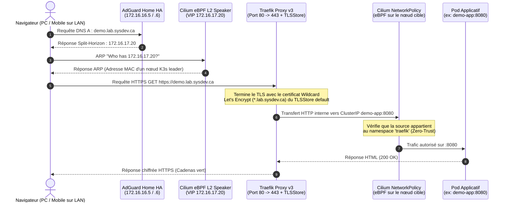
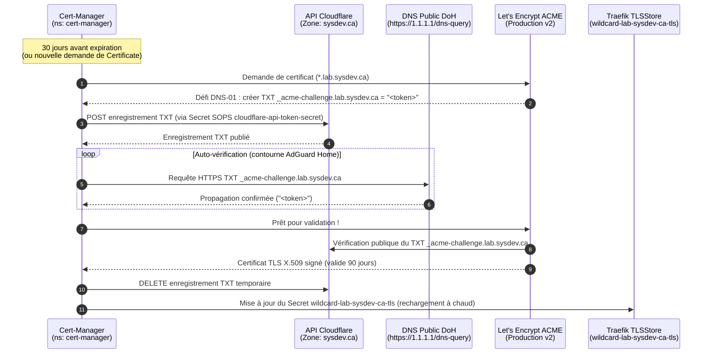

# 🛠️ Guide d'Administration & d'Exploitation au Quotidien (Jour 2)

Ce manuel opérationnel est votre référence complète pour **surveiller, exploiter, faire évoluer et dépanner** votre cluster Kubernetes DevSecOps (`*.lab.sysdev.ca`) au quotidien.

> [!IMPORTANT]
> **Règle d'or du GitOps :** Ne modifiez jamais la configuration des applications directement avec `kubectl edit` ou `kubectl apply` en production (sauf pour un test ponctuel). **Tout changement durable doit être commité (signé GPG `-S -s`) dans Git** puis fusionné via une Pull Request sur `main`. FluxCD détecte la signature GPG du commit `HEAD` et applique le changement automatiquement en moins de 60 secondes.

---

## 1. Check-up de santé du cluster en 60 secondes

Depuis le terminal de votre **DevContainer**, exécutez ces commandes pour vérifier que chaque couche fonctionne parfaitement :

```bash
# 1. Santé des 3 nœuds Kubernetes et de la VIP HA Keepalived (172.16.17.220:6443)
kubectl cluster-info
kubectl get nodes -o wide

# 2. Santé de la synchronisation GitOps FluxCD (tous à 'READY: True')
flux get all

# 3. Santé du réseau eBPF Cilium, du chiffrement WireGuard et du pool L2 (172.16.17.20 à .219)
kubectl -n kube-system exec ds/cilium -- cilium-dbg status --brief
kubectl -n kube-system exec ds/cilium -- cilium-dbg encrypt status
kubectl get ciliumloadbalancerippools,ciliuml2announcementpolicies -A

# 4. Santé du stockage distribué Piraeus / LINSTOR / DRBD 9 (tous les réplicas 'UpToDate' et 'Established(2)')
kubectl exec -n piraeus-datastore deploy/linstor-controller -- linstor storage-pool list
kubectl exec -n piraeus-datastore deploy/linstor-controller -- linstor volume list

# 5. Santé du quorum Raft de HashiCorp Vault (1 leader + 2 followers, tous 'Sealed: false')
ROOT_TOKEN=$(jq -r '.root_token' ~/.ssh/vault-init.json)
kubectl exec -n vault vault-0 -- vault status
kubectl exec -n vault vault-0 -- env VAULT_TOKEN="$ROOT_TOKEN" vault operator raft list-peers

# 6. Santé d'Authentik SSO, des certificats TLS Let's Encrypt et d'External Secrets Operator (ESO)
kubectl get pods -n authentik
kubectl get clusterissuer,certificate -A
kubectl get clustersecretstore,externalsecret -A

# 7. Santé des politiques d'admission Kyverno v1.20 (CEL)
kubectl get validatingpolicy,imagevalidatingpolicy
```

---

## 2. Gérer le cycle de vie des applications (Ajouter, Modifier, Supprimer)

Toutes vos applications personnelles vivent dans le dossier **`cluster/apps/`**, qui est surveillé en continu par la `Kustomization` FluxCD **`apps`** (`cluster/clusters/homelab/apps.yaml`, avec `prune: true`).

### 2.1 Ajouter une nouvelle application (Exemple complet : `mon-app`)

Voici la marche à suivre standard pour déployer n'importe quelle application web (ex. un outil personnel, une API, un tableau de bord) sur **`https://mon-app.lab.sysdev.ca`** :

1. **Créez un dossier dédié** : `cluster/apps/mon-app/`
2. **Créez le manifeste `cluster/apps/mon-app/app.yaml`** respectant vos standards de sécurité (**PSA Restricted**, **Checkov**, **NetworkPolicy**, **Limites CPU/RAM**) :

```yaml
---
# 1. Namespace isolé avec Pod Security Standard "Restricted"
apiVersion: v1
kind: Namespace
metadata:
  name: mon-app
  labels:
    pod-security.kubernetes.io/enforce: restricted
    pod-security.kubernetes.io/audit: restricted
    pod-security.kubernetes.io/warn: restricted
---
# 2. Déploiement applicatif durci
apiVersion: apps/v1
kind: Deployment
metadata:
  name: mon-app
  namespace: mon-app
spec:
  replicas: 2 # Haute disponibilité sur 2 nœuds différents
  selector:
    matchLabels:
      app.kubernetes.io/name: mon-app
  template:
    metadata:
      labels:
        app.kubernetes.io/name: mon-app
    spec:
      automountServiceAccountToken: false
      securityContext:
        runAsNonRoot: true
        runAsUser: 10001      # UID >= 10000 (Checkov CKV_K8S_40)
        runAsGroup: 10001
        fsGroup: 10001
        seccompProfile:
          type: RuntimeDefault
      containers:
        - name: mon-app
          image: ghcr.io/organisation/mon-image:1.2.3 # Toujours figer une version (pas :latest)
          imagePullPolicy: IfNotPresent
          ports:
            - name: http
              containerPort: 8080
          securityContext:
            allowPrivilegeEscalation: false
            privileged: false
            readOnlyRootFilesystem: true
            capabilities:
              drop: ["ALL"]
          resources:
            requests:
              cpu: 50m      # 0.05 cœur CPU réservé garanti
              memory: 64Mi  # 64 Mio RAM réservés garantis
            limits:
              cpu: 250m     # Plafond à 0.25 cœur CPU
              memory: 128Mi # Plafond strict (OOMKilled si dépassé)
          livenessProbe:
            httpGet:
              path: /healthz
              port: http
            initialDelaySeconds: 5
            periodSeconds: 10
          readinessProbe:
            httpGet:
              path: /healthz
              port: http
            initialDelaySeconds: 3
            periodSeconds: 5
---
# 3. Service interne (ClusterIP)
apiVersion: v1
kind: Service
metadata:
  name: mon-app
  namespace: mon-app
spec:
  selector:
    app.kubernetes.io/name: mon-app
  ports:
    - name: http
      port: 80
      targetPort: http
---
# 4. Micro-segmentation réseau Cilium eBPF (Checkov CKV2_K8S_6)
apiVersion: networking.k8s.io/v1
kind: NetworkPolicy
metadata:
  name: mon-app-netpol
  namespace: mon-app
spec:
  podSelector:
    matchLabels:
      app.kubernetes.io/name: mon-app
  policyTypes:
    - Ingress
    - Egress
  ingress:
    - from:
        - namespaceSelector:
            matchLabels:
              kubernetes.io/metadata.name: traefik
      ports:
        - protocol: TCP
          port: 8080
  egress: [] # Ajoutez une règle Egress DNS (UDP/53) + HTTPS (TCP/443) si l'app doit appeler Internet
---
# 5. Exposition HTTPS via Traefik (certificat Wildcard *.lab.sysdev.ca automatique !)
apiVersion: networking.k8s.io/v1
kind: Ingress
metadata:
  name: mon-app-ingress
  namespace: mon-app
  annotations:
    traefik.ingress.kubernetes.io/router.entrypoints: websecure
    traefik.ingress.kubernetes.io/router.tls: "true"
spec:
  ingressClassName: traefik
  rules:
    - host: mon-app.lab.sysdev.ca
      http:
        paths:
          - path: /
            pathType: Prefix
            backend:
              service:
                name: mon-app
                port:
                  number: 80
```

3. **Référencez le fichier dans `cluster/apps/kustomization.yaml`** :
   ```yaml
   resources:
     - namespace.yaml
     - external-secret.yaml
     - demo-app/deployment.yaml
     - mon-app/app.yaml
   ```
4. **Validez localement, commitez et fusionnez via Pull Request** :
   ```bash
   kubectl kustomize cluster/apps > /dev/null
   checkov -d ./cluster/apps/mon-app --framework kubernetes --quiet --compact
   git switch -c feat/add-mon-app
   git add cluster/apps/
   git commit -S -s -m "feat(apps): deploy mon-app on mon-app.lab.sysdev.ca"
   git push -u origin feat/add-mon-app
   ```
   Dès que la PR est fusionnée sur `main`, FluxCD crée le namespace, le déploiement, la `NetworkPolicy` et l'`Ingress`. **`https://mon-app.lab.sysdev.ca` est immédiatement accessible en HTTPS sans rien toucher dans AdGuard Home ni dans Cert-Manager !**

### 2.2 Supprimer proprement une application

Grâce à l'option **`prune: true`** configurée sur la `Kustomization` `apps` de FluxCD :
1. Retirez la ligne `- mon-app/app.yaml` de `cluster/apps/kustomization.yaml`.
2. Supprimez le dossier `cluster/apps/mon-app/`.
3. Commitez (signé GPG) et fusionnez la PR sur `main`.
4. FluxCD détecte que les ressources ne figurent plus dans Git et **supprime automatiquement** l'`Ingress`, le `Service`, la `NetworkPolicy`, le `Deployment` et le `Namespace` dans le cluster !

---

## 3. Gestion des Ressources (CPU / RAM) et Scaling (Upscale / Downscale)

### 3.1 Comprendre `requests` vs `limits` dans Kubernetes

Sur chacun de vos 3 conteneurs K3s (`12 Go RAM` / `4 vCPU` alloués par Incus), Kubernetes utilise les `cgroups v2` pour gérer deux seuils :

| Paramètre | Unité courante | Rôle exact |
| :--- | :--- | :--- |
| **`requests.cpu`** | `100m` = 0,1 cœur (`1000m` = 1 vCPU) | Quantité **garantie** réservée pour l'ordonnancement (*scheduling*) par le *kube-scheduler*. |
| **`limits.cpu`** | `500m` = 0,5 cœur | Plafond maximal. Si le conteneur dépasse, le noyau Linux le ralentit (*CPU throttling*), **sans le tuer**. |
| **`requests.memory`** | `64Mi`, `512Mi`, `1Gi` | Quantité de RAM **garantie** au démarrage. |
| **`limits.memory`** | `128Mi`, `1Gi`, `2Gi` | Plafond absolu. Si le conteneur dépasse cette limite, le noyau le tue immédiatement (**`OOMKilled`** / `Exit Code 137`). |

> [!TIP]
> Pour savoir combien de CPU/RAM consomment réellement vos pods avant d'ajuster leurs limites :
> ```bash
> kubectl top nodes
> kubectl top pods -A --sort-by=memory
> ```

### 3.2 Upscale / Downscale (Mise à l'échelle horizontale)

- **Méthode GitOps (Permanente — recommandée) :**
  Modifiez simplement `spec.replicas: 2` $\rightarrow$ `spec.replicas: 3` (upscale) ou `spec.replicas: 0` (arrêt complet / downscale) dans le fichier `deployment.yaml` de votre application, puis poussez une PR sur `main`.
- **Méthode d'urgence temporaire (CLI) :**
  Si vous devez scaler en urgence pour un test ou une maintenance sans attendre une PR, **suspendez d'abord la réconciliation FluxCD** (sinon FluxCD remettra le nombre de réplicas défini dans Git au bout de 10 minutes !) :
  ```bash
  # 1. Mettre en pause la réconciliation de la Kustomization 'apps'
  flux suspend kustomization apps

  # 2. Modifier le nombre de réplicas en direct (ex: passer demo-app à 3 réplicas, ou 0 pour l'arrêter)
  kubectl scale deployment demo-app -n demo-app --replicas=3

  # 3. Une fois le test terminé, réactiver FluxCD (qui réalignera le cluster sur Git)
  flux resume kustomization apps
  ```

---

## 4. Réseau, Routage Traefik et Exposition Hors Cluster

### 4.1 Diagramme de séquence : Trajet d'une requête HTTPS vers une application



### 4.2 Exposer une route HTTP/HTTPS dans Traefik : `Ingress` vs `IngressRoute`

Traefik dans votre cluster supporte **deux syntaxes** (toutes deux bénéficient automatiquement de la redirection HTTP $\rightarrow$ HTTPS et du certificat Wildcard `*.lab.sysdev.ca` via le `TLSStore` `default`) :

1. **Syntaxe standard Kubernetes `Ingress` (recommandée pour 90 % des cas) :**
   Portable sur n'importe quel cluster Kubernetes. Il suffit d'indiquer :
   - `spec.ingressClassName: traefik`
   - `annotations`:
     - `traefik.ingress.kubernetes.io/router.entrypoints: websecure`
     - `traefik.ingress.kubernetes.io/router.tls: "true"`
   - `host: <nom>.lab.sysdev.ca`
2. **Syntaxe avancée CRD Traefik `IngressRoute` (ex. [`traefik-dashboard`](../cluster/infrastructure/configs/pki-letsencrypt.yaml)) :**
   Indispensable lorsque vous voulez utiliser des fonctions avancées de Traefik comme des règles de routage complexes (`Host(...) && PathPrefix(...)`) ou des **Middlewares** (réécriture d'URL `StripPrefix`, authentification `BasicAuth`, limitation de débit `RateLimit`, en-têtes de sécurité HSTS) :
   ```yaml
   apiVersion: traefik.io/v1alpha1
   kind: IngressRoute
   metadata:
     name: mon-app-avancee
     namespace: mon-app
   spec:
     entryPoints:
       - websecure
     routes:
       - match: Host(`api.lab.sysdev.ca`) && PathPrefix(`/v1`)
         kind: Rule
         services:
           - name: mon-app
             port: 80
     tls: {} # Utilise automatiquement le certificat Wildcard du TLSStore par défaut
   ```

### 4.3 Protéger une application avec Authentik SSO (ForwardAuth)

Grâce au middleware global `authentik-forward-auth` (namespace `authentik`, utilisable cross-namespace) et au Blueprint `homelab-domain-auth` (`cookie_domain: lab.sysdev.ca`), vous pouvez protéger **n'importe quelle application `*.lab.sysdev.ca`** derrière votre portail SSO **`https://auth.lab.sysdev.ca`** en 1 ligne :

- **Sur un `Ingress` standard :** ajoutez simplement l'annotation :
  ```yaml
  metadata:
    annotations:
      traefik.ingress.kubernetes.io/router.middlewares: authentik-authentik-forward-auth@kubernetescrd
  ```
- **Sur un `IngressRoute` Traefik :** ajoutez le bloc `middlewares` :
  ```yaml
  middlewares:
    - name: authentik-forward-auth
      namespace: authentik
  ```

### 4.4 Exposer un service non-HTTP (TCP/UDP : Base de données, MQTT, SSH, Serveur de jeu)

Si vous souhaitez exposer un pod directement sur votre réseau local `172.16.17.x` **sans passer par Traefik**, créez un `Service` de type **`LoadBalancer`**. Cilium L2 lui attribuera automatiquement une IP libre dans la plage `172.16.17.20` – `172.16.17.219` (`172.16.17.220` étant réservée à la VIP HA Keepalived de l'API K3s) :

```yaml
apiVersion: v1
kind: Service
metadata:
  name: mon-service-tcp
  namespace: mon-app
  annotations:
    io.cilium/lb-ipam-ips: "172.16.17.25" # Optionnel : fixe l'IP exacte dans le pool L2
spec:
  type: LoadBalancer
  selector:
    app.kubernetes.io/name: mon-app
  ports:
    - name: postgres
      port: 5432
      targetPort: 5432
      protocol: TCP
```

### 4.4 Exposer une application vers l'extérieur (Internet) en toute sécurité

**N'ouvrez jamais les ports 80 ou 443 sur votre routeur domestique.** Puisque votre domaine `sysdev.ca` est déjà hébergé sur **Cloudflare Free**, la méthode Zero-Trust recommandée consiste à déployer un connecteur **`cloudflared` (Cloudflare Tunnel)** en GitOps dans votre cluster K3s : le pod établit un tunnel sortant chiffré vers Cloudflare et ne publie que les sous-domaines que vous choisissez (protégés par *Cloudflare Access* avec authentification MFA).

---

## 5. Gestion de la PKI et des Certificats TLS (Cert-Manager & Let's Encrypt)

### 5.1 Durée de vie et renouvellement automatique

- **Durée de vie d'un certificat Let's Encrypt :** **90 jours**.
- **Renouvellement automatique :** Cert-Manager surveille chaque objet `Certificate` en continu et déclenche automatiquement le renouvellement **30 jours avant expiration** (soit au bout de **60 jours**, configurable via `spec.renewBefore`).
- **Zéro interruption de service :** Une fois le nouveau certificat émis via le défi DNS-01 Cloudflare, Cert-Manager met à jour le Secret `wildcard-lab-sysdev-ca-tls` dans le namespace `traefik` et Traefik le recharge à chaud en mémoire sans redémarrer.

### 5.2 Diagramme de séquence : Émission et renouvellement ACME DNS-01 (DoH)



### 5.3 Commandes utiles sur les certificats

```bash
# 1. Voir tous les certificats, leur statut READY et leur date d'expiration (Not After)
kubectl get certificate -A
kubectl describe certificate wildcard-lab-sysdev-ca -n traefik | grep -E "Not After|Renewal Time|Status:|Message:"

# 2. Forcer un renouvellement manuel immédiat (ex. en cas de compromission de clé privée)
kubectl delete secret wildcard-lab-sysdev-ca-tls -n traefik
# Cert-Manager détecte immédiatement la disparition du Secret et réémet un nouveau certificat en ~60s !
```

### 5.4 Comment demander un nouveau certificat TLS (autre domaine ou certificat dédié)

Tant que vous utilisez `*.lab.sysdev.ca`, **vous n'avez besoin d'aucun autre certificat** (le Wildcard couvre déjà tous les sous-domaines de niveau 1 sous `lab.sysdev.ca`).
Si toutefois vous avez besoin d'un certificat dédié (par exemple pour `*.prod.sysdev.ca` ou `app.sysdev.ca`), créez simplement un objet `Certificate` référençant votre `ClusterIssuer` existant **`letsencrypt-prod`** :

```yaml
apiVersion: cert-manager.io/v1
kind: Certificate
metadata:
  name: mon-autre-certificat
  namespace: mon-app
spec:
  secretName: mon-autre-certificat-tls
  issuerRef:
    name: letsencrypt-prod
    kind: ClusterIssuer
  dnsNames:
    - "autre.sysdev.ca"
```
Puis référencez `secretName: mon-autre-certificat-tls` dans le bloc `spec.tls` de votre `Ingress`.

---

## 6. Gestion des Secrets (Vault HA, External Secrets & Mozilla SOPS)

### 6.1 Ajouter ou modifier un secret dans HashiCorp Vault (pour une application)

Vous pouvez ajouter des secrets de deux façons :
1. **Par l'interface Web :** Ouvrez **`https://vault.lab.sysdev.ca`**, connectez-vous avec votre `root_token` (`jq -r '.root_token' ~/.ssh/vault-init.json`), cliquez sur **`secret/`** $\rightarrow$ **Create secret** (ex. chemin `mon-app/config`).
2. **Par ligne de commande (DevContainer) :**
   ```bash
   ROOT_TOKEN=$(jq -r '.root_token' ~/.ssh/vault-init.json)
   kubectl exec -n vault vault-0 -- env VAULT_TOKEN="$ROOT_TOKEN" \
     vault kv put secret/mon-app/config api_key="ma-valeur-secrete"
   ```
3. **Le synchroniser dans Kubernetes via `ExternalSecret` :**
   Créez un objet `ExternalSecret` dans le namespace `mon-app` pointant vers `secretStoreRef: { name: vault-backend, kind: ClusterSecretStore }`, puis montez le `Secret` généré en tant que **volume fichier en lecture seule (`/etc/secrets`)** dans votre `Deployment` (règle Checkov `CKV_K8S_35`).

### 6.2 Chiffrer un secret statique d'infrastructure avec Mozilla SOPS / Age

Utilisez SOPS uniquement pour les secrets dont l'infrastructure a besoin **avant** Vault (comme `cloudflare-secret.sops.yaml`). Toute règle correspondant à `cluster/.*\.sops\.ya?ml$` dans `.sops.yaml` chiffre automatiquement les clés `data` et `stringData` :

```bash
# Chiffrer un fichier existant sur place (ne jamais commiter le fichier avant chiffrement !)
sops --encrypt --in-place cluster/infrastructure/configs/mon-secret.sops.yaml

# Éditer un secret SOPS chiffré de manière transparente dans vim (déchiffré en mémoire puis rechiffré à la sauvegarde)
sops cluster/infrastructure/configs/mon-secret.sops.yaml
```

### 6.3 Procédure obligatoire après redémarrage d'un serveur physique : Déverrouiller (*Unseal*) Vault

Par conception de sécurité, lorsqu'un pod Vault redémarre (coupure de courant, mise à jour du noyau Ubuntu), il démarre **scellé (`Sealed: true`)** afin qu'aucune donnée en mémoire ne soit lisible sans l'intervention de l'administrateur.

Exécutez ce script rapide depuis votre DevContainer pour déverrouiller tous les nœuds scellés en 5 secondes :

```bash
UNSEAL_1=$(jq -r '.unseal_keys_b64[0]' ~/.ssh/vault-init.json)
UNSEAL_2=$(jq -r '.unseal_keys_b64[1]' ~/.ssh/vault-init.json)
UNSEAL_3=$(jq -r '.unseal_keys_b64[2]' ~/.ssh/vault-init.json)

for pod in vault-0 vault-1 vault-2; do
  if kubectl exec -n vault "$pod" -- vault status 2>/dev/null | grep -q "Sealed.*true"; then
    echo "🔓 Déverrouillage de $pod..."
    for key in "$UNSEAL_1" "$UNSEAL_2" "$UNSEAL_3"; do
      kubectl exec -n vault "$pod" -- vault operator unseal "$key" >/dev/null
    done
  else
    echo "✅ $pod est déjà déverrouillé."
  fi
done
```

---

## 7. Stockage Distribué (Piraeus Operator v2 / LINSTOR / DRBD 9)

### 7.1 Attacher un volume persistant répliqué 3x à une application

Il suffit de déclarer un **`PersistentVolumeClaim`** utilisant la classe par défaut **`piraeus-storage-replicated`**. Piraeus créera automatiquement un bloc DRBD 9 répliqué de manière synchrone sur vos 3 machines physiques :

```yaml
apiVersion: v1
kind: PersistentVolumeClaim
metadata:
  name: mon-app-data
  namespace: mon-app
spec:
  accessModes:
    - ReadWriteOnce
  storageClassName: piraeus-storage-replicated
  resources:
    requests:
      storage: 5Gi
```

### 7.2 Agrandir un volume existant (Online Volume Expansion)

Comme `allowVolumeExpansion: true` est activé sur `piraeus-storage-replicated`, il suffit d'augmenter la valeur `spec.resources.requests.storage` (ex. `5Gi` $\rightarrow$ `10Gi`) dans le manifeste Git du PVC et de fusionner la PR : LINSTOR et DRBD 9 agrandissent le volume et le système de fichiers `ext4` à chaud.

---

## 8. Maintenance et Mises à Jour (Jour 2)

| Cible | Comment mettre à jour sans coupure | Fréquence conseillée |
| :--- | :--- | :--- |
| **3 Hôtes physiques Ubuntu 26.04 & Incus 7.5** | `ansible-playbook -i infrastructure/ansible/inventory/baremetal.yml infrastructure/ansible/playbook-hosts.yml --tags update -e serial_update=1` *(redémarre 1 PC à la fois pour préserver le quorum `etcd`, DRBD 9 et Vault Raft ; penser à *unseal* le pod Vault du nœud redémarré ensuite)* | 1 fois / mois |
| **12 Outils CLI du DevContainer & CI** | Automatique ! Le workflow **`update-cli-tools.yml`** ouvre une PR signée GPG chaque lundi s'il détecte de nouvelles releases. | Automatique (Hebdomadaire) |
| **Actions GitHub (`actions/checkout`, etc.)** | Automatique ! **Dependabot** (`.github/dependabot.yml`) ouvre les PRs de mise à jour. | Automatique |
| **Charts Helm Kubernetes (`cert-manager`, `traefik`, `vault`, etc.)** | Les `HelmRelease` utilisent des contraintes SemVer (ex. `>= 39.0.0`) que FluxCD vérifie toutes les 12h. | Automatique (FluxCD) |

---

## 9. Fiche de Dépannage Rapide (Troubleshooting)

| Symptôme | Commande de diagnostic | Résolution type |
| :--- | :--- | :--- |
| **FluxCD ne synchronise plus** | `flux get sources git` & `flux get kustomizations` | Vérifier que le commit `HEAD` sur `main` est signé GPG (clé dans `flux-pgp-public-keys`) et forcer `flux reconcile source git flux-system`. |
| **Un Pod est bloqué à la création dans `demo-app`** | `kubectl describe rs -n demo-app` | Vérifier si **Kyverno** a rejeté l'image (non signée par `supply-chain.yml`) ou si le Pod viole **PSA Restricted** (UID non-root, `drop ALL`). |
| **Un Pod est `CrashLoopBackOff` / `OOMKilled`** | `kubectl logs <pod> -n <ns> --previous` | Si `OOMKilled` (`Exit Code 137`), augmenter `resources.limits.memory` dans le `Deployment`. |
| **Un site `*.lab.sysdev.ca` ne répond pas** | `dig +short mon-app.lab.sysdev.ca @172.16.16.5` et `kubectl get ingress -A` | Vérifier que le DNS renvoie `172.16.17.20`, que les pods sont `Ready` et que la `NetworkPolicy` autorise le namespace `traefik`. |
| **Un `ExternalSecret` est en erreur** | `kubectl describe externalsecret <nom> -n <ns>` | Vérifier que Vault n'est pas scellé (`kubectl exec -n vault vault-0 -- vault status`) et que le chemin existe bien sous `secret/` dans Vault. |
| **Un `PVC` reste en `Pending`** | `kubectl describe pvc <nom> -n <ns>` et `linstor error-reports list` | Vérifier que `/dev/loop0..63` et `/dev/drbd1000..1063` existent sur les 3 nœuds et que `cat /sys/module/drbd/parameters/usermode_helper` retourne `disabled` sur les 3 hôtes physiques. |
