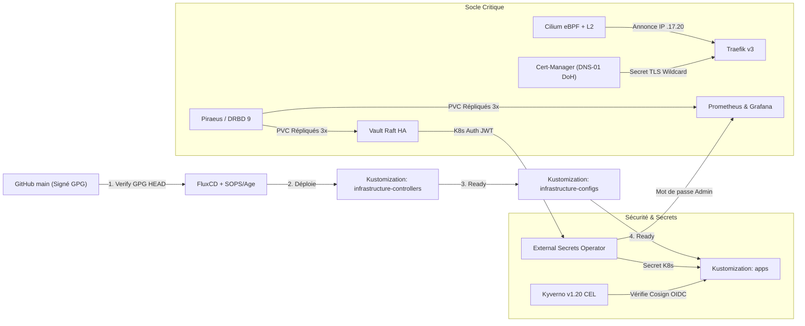
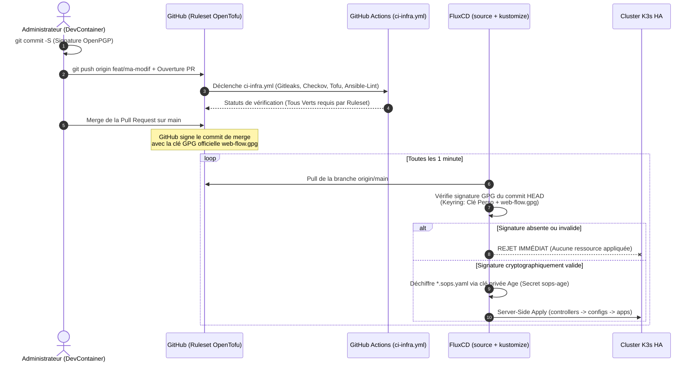
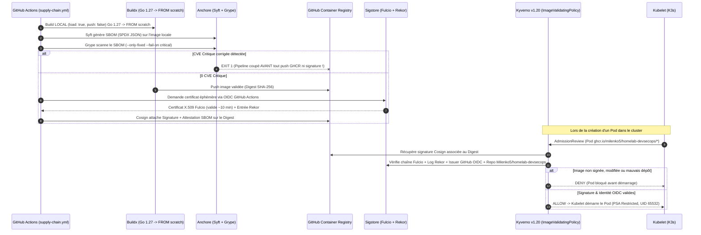
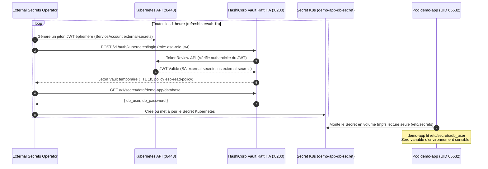
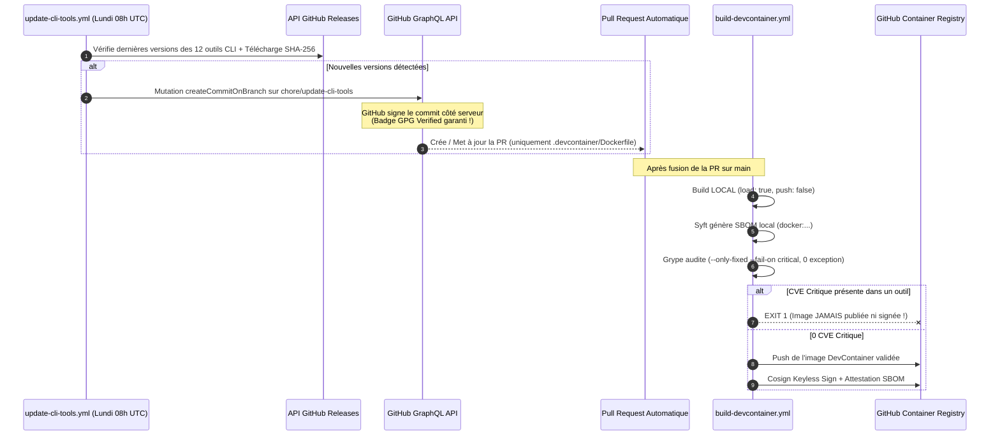

# 🧠 Référence Architecturale Complète & Anatomie du Dépôt (Vitrine DevSecOps)

Ce document est la **référence technique et architecturale** du projet `homelab-devsecops`. Il permet de comprendre précisément le rôle de **chaque fichier**, chaque choix d'architecture, et les interactions exactes entre tous les composants afin de faire évoluer le cluster en toute autonomie.

> Pour les commandes quotidiennes d'exploitation (ajout d'apps, CPU/RAM, scaling, certificats, Vault, dépannage), consultez le **[Guide d'Administration & Usage au Quotidien](guide-administration-quotidienne.md)**.

---

## 📑 Table des Matières

1. [Vue d'Ensemble & Matrice des Liens entre Composants](#1-vue-densemble--matrice-des-liens-entre-composants)
2. [Diagrammes de Séquence des 4 Chaînes Critiques](#2-diagrammes-de-séquence-des-4-chaînes-critiques)
   - [2.1 Chaîne GitOps Zero-Trust (GPG, CI, FluxCD, SOPS/Age)](#21-chaîne-gitops-zero-trust-gpg-ci-fluxcd-sopsage)
   - [2.2 Chaîne Supply Chain & Admission (Syft, Grype, Cosign, Kyverno CEL)](#22-chaîne-supply-chain--admission-syft-grype-cosign-kyverno-cel)
   - [2.3 Chaîne Secrets Zero-Trust (Vault Raft HA, Kubernetes Auth, ESO)](#23-chaîne-secrets-zero-trust-vault-raft-ha-kubernetes-auth-eso)
   - [2.4 Maintenance Automatisée & Audit Strict du DevContainer](#24-maintenance-automatisée--audit-strict-du-devcontainer)
3. [Anatomie Exhaustive : Explication de Chaque Fichier du Dépôt](#3-anatomie-exhaustive--explication-de-chaque-fichier-du-dépôt)
   - [3.1 Fichiers Racine (Sécurité & Conventions)](#31-fichiers-racine-sécurité--conventions)
   - [3.2 `.devcontainer/` (Poste d'Administration Immuable)](#32-devcontainer-poste-dadministration-immuable)
   - [3.3 `.github/` (Pipelines CI/CD & Gouvernance)](#33-github-pipelines-cicd--gouvernance)
   - [3.4 `infrastructure/terraform/` (OpenTofu — Provisionnement & Gouvernance)](#34-infrastructureterraform-opentofu--provisionnement--gouvernance)
   - [3.5 `infrastructure/ansible/` (Configuration OS, Incus & K3s HA)](#35-infrastructureansible-configuration-os-incus--k3s-ha)
   - [3.6 `cluster/clusters/homelab/` (Point d'Entrée FluxCD)](#36-clusterclustershomelab-point-dentrée-fluxcd)
   - [3.7 `cluster/infrastructure/controllers/` (Opérateurs & Services Socle)](#37-clusterinfrastructurecontrollers-opérateurs--services-socle)
   - [3.8 `cluster/infrastructure/configs/` (Configurations & Politiques)](#38-clusterinfrastructureconfigs-configurations--politiques)
   - [3.9 `cluster/apps/` (Workloads Applicatifs & `demo-app`)](#39-clusterapps-workloads-applicatifs--demo-app)
   - [3.10 `scripts/` (Utilitaires d'Amorçage & Sécurité)](#310-scripts-utilitaires-damorçage--sécurité)
   - [3.11 `docs/` (Documentation & ADR)](#311-docs-documentation--adr)

---

## 1. Vue d'Ensemble & Matrice des Liens entre Composants

Le homelab repose sur une **séparation stricte en 4 niveaux** (*Layered Architecture*), où chaque outil a un périmètre exclusif et ne marche jamais sur les plates-bandes du suivant :

| Niveau | Outil | Responsabilité Exclusive | Ne fait JAMAIS |
| :--- | :--- | :--- | :--- |
| **Niveau 0 (Bare-Metal)** | **Ansible** (`playbook-hosts.yml`) | Prépare les 3 serveurs physiques Ubuntu 26.04 (DRBD 9 DKMS, module noyau, Incus 7.5, bridge `br0`, API mTLS `:8443`). | Ne crée pas les conteneurs LXC, ne déploie pas K3s. |
| **Niveau 1 (IaC & Cloud/DNS)** | **OpenTofu** (`infrastructure/terraform/`) | Crée les 3 conteneurs LXC via API Incus mTLS, applique les *GitHub Rulesets* & permissions CI, configure Cloudflare CAA + AdGuard Home HA. | Ne se connecte jamais en SSH dans les LXC, ne gère pas les pods K8s. |
| **Niveau 2 (OS & Cluster K3s)** | **Ansible** (`playbook.yml`) | Durcit les 3 LXC (`os_prep`, `/dev/loop*`, `/dev/drbd*`), initialise le quorum K3s HA (`etcd` embarqué), installe Cilium eBPF (sans `kube-proxy` ni Traefik intégré). | Ne déploie pas les applications ou contrôleurs GitOps. |
| **Niveau 3 (GitOps & Runtime)** | **FluxCD** (`cluster/`) | Synchronise en continu l'état déclaratif du dépôt Git (après vérification GPG du commit `HEAD` + déchiffrement SOPS/Age) : Piraeus, Cert-Manager, Traefik, Vault, ESO, Kyverno, Prometheus/Grafana, `demo-app`. | Ne modifie pas l'infrastructure physique ni les règles GitHub. |

### Plan d'Adressage Réseau (`172.16.16.0/23` ou VLAN LAN)

| IP | Composant | Rôle & Protocole |
| :--- | :--- | :--- |
| `172.16.16.5` / `172.16.16.6` | **AdGuard Home HA** (Externe) | DNS interne Split-Horizon : résout `*.lab.sysdev.ca` -> `172.16.17.20`. Géré par OpenTofu (`dns.tf`). |
| `172.16.17.240` / `.241` / `.242` | **Hôtes physiques Intel x86_64** | 3 × 16 Go RAM, Ubuntu 26.04 LTS, Incus 7.5 (API mTLS `:8443`), module noyau `drbd` (DRBD 9.3.1). |
| `172.16.17.220` | **VIP HA Keepalived — API K3s** | IP virtuelle VRRP Unicast basculant entre `k3s-srv-01/02/03` (< 2 s). Cible unique de `kubectl`, des nœuds K3s et de Cilium `k8sServiceHost` (`:6443`). |
| `172.16.17.221` / `.222` / `.223` | **`k3s-srv-01` / `02` / `03`** | Conteneurs système Incus LXC privilégiés sur bridge `br0`. Quorum `etcd` (secrets chiffrés au repos) + API K8s (`:6443`) + Satellites LINSTOR/DRBD 9 + Cilium WireGuard. |
| `172.16.17.20` | **VIP Cilium L2 — Traefik** | IP virtuelle annoncée en ARP par Cilium L2 (`CiliumLoadBalancerIPPool` `.20–.219`). Point d'entrée unique HTTP/HTTPS (`80`/`443`). |
| `172.16.17.21` à `.219` | **Pool VIP Cilium L2** | Réservé pour d'éventuels Services `LoadBalancer` non-HTTP (PostgreSQL, MQTT, SSH, etc.). |

### Matrice des Dépendances entre Contrôleurs du Cluster

---

## 2. Diagrammes de Séquence des 4 Chaînes Critiques

### 2.1 Chaîne GitOps Zero-Trust (GPG, CI, FluxCD, SOPS/Age)

Ce diagramme montre comment **aucun code non signé ou vulnérable** ne peut jamais atteindre le cluster Kubernetes, même si un attaquant volait un jeton GitHub ou compromettait un poste sans la clé privée GPG.

### 2.2 Chaîne Supply Chain & Admission (Syft, Grype, Cosign, Kyverno CEL)

Ce diagramme illustre le pipeline **Shift-Left -> Shield-Right** pour l'application `demo-app` (`ghcr.io/milenko5/homelab-devsecops/demo-app`).

### 2.3 Chaîne Secrets Zero-Trust (Vault Raft HA, Kubernetes Auth, ESO)

Aucun mot de passe applicatif n'est stocké dans Git (même chiffré) ni exposé dans des variables d'environnement `env` (qui fuitent dans `/proc/1/environ` ou les crash dumps — règle Checkov `CKV_K8S_35`).

### 2.4 Maintenance Automatisée & Audit Strict du DevContainer

Pour éviter de publier une image DevContainer contenant une CVE critique **et** garder les 12 outils CLI à jour automatiquement (avec commits signés GPG `Verified`), deux workflows coopèrent autour d'une **Source Unique de Vérité** (`.devcontainer/Dockerfile`).

---

## 3. Anatomie Exhaustive : Explication de Chaque Fichier du Dépôt

Voici l'inventaire complet de **chaque fichier** présent dans `homelab-devsecops/`, son rôle exact et les subtilités techniques qu'il contient.

### 3.1 Fichiers Racine (Sécurité & Conventions)

| Fichier | Rôle & Contenu Détaillé |
| :--- | :--- |
| **`.env.example`** | Modèle des variables d'environnement sensibles requises par OpenTofu (`TF_VAR_github_token`, `TF_VAR_cloudflare_api_token`, `TF_VAR_adguard_password`, `TF_VAR_state_passphrase`, etc.). Contient uniquement des valeurs factices. |
| **`.env`** | *(Ignoré par Git)* Copie locale réelle de `.env.example` contenant vos vrais jetons. Chargé manuellement (`set -a; source .env; set +a`) avant d'exécuter `tofu`. |
| **`.gitignore`** | Empêche de committer `.env`, les clés privées (`*.key`, `age.agekey`), les fichiers d'état Terraform non chiffrés, `.terraform/`, et les artefacts locaux. |
| **`.gitattributes`** | Force les fins de ligne UNIX (`eol=lf`) pour tous les fichiers texte (`* text=auto eol=lf`). Indispensable sous Windows pour éviter que `ansible-lint`, `bash` ou `sops` n'échouent à cause de retours chariot `\r\n` (CRLF). |
| **`.gitleaks.toml`** | Configuration du scanner de secrets **Gitleaks**. Étend les règles par défaut (`[extend] useDefault = true`) tout en autorisant explicitement `.env.example` (faux positif sur les placeholders) et les fichiers `cluster/.*\.sops\.ya?ml$` (qui contiennent des données chiffrées Age). |
| **`.sops.yaml`** | Règle de chiffrement **Mozilla SOPS** : indique que tout fichier `*.sops.yaml` doit être chiffré avec votre clé publique **Age** (`age1...`), et **uniquement** sur les champs sensibles (`encrypted_regex: ^(data|stringData)$`) afin de garder les métadonnées Kubernetes (`metadata`, `kind`) lisibles en clair dans Git. |
| **`README.md`** | Vitrine publique du projet sur GitHub : objectifs, pile technologique, diagramme d'architecture global, tableau des portails HTTPS actifs et liens vers toute la documentation. |

---

### 3.2 `.devcontainer/` (Poste d'Administration Immuable)

| Fichier | Rôle & Contenu Détaillé |
| :--- | :--- |
| **`.devcontainer/Dockerfile`** | **Source Unique de Vérité (SSOT)** des 12 outils CLI d'administration (`tofu`, `kubectl`, `helm`, `flux`, `cilium`, `sops`, `age`, `gitleaks`, `syft`, `grype`, `cosign`, `tflint`) ainsi que `ansible`, `ansible-lint`, `checkov`, `vim`, `jq`, `yq`. Construit sur **Ubuntu 26.04**, chaque binaire est téléchargé par version exacte et **vérifié cryptographiquement par somme `SHA-256`** avant installation. Les workflows CI lisent ce fichier dynamiquement pour rester 100 % synchronisés. |
| **`.devcontainer/devcontainer.json`** | Configuration VS Code DevContainer : utilise l'image préconstruite GHCR (`ghcr.io/milenko5/homelab-devsecops/devcontainer:latest`), monte le dossier `~/.ssh` hôte (clé SSH Ed25519, `homelab.kubeconfig`, certificat mTLS `incus-client`), transmet l'agent GPG, et exécute `postStartCommand` pour restaurer automatiquement `~/.kube/config` et le certificat client Incus à chaque démarrage du conteneur. |

---

### 3.3 `.github/` (Pipelines CI/CD & Gouvernance)

| Fichier | Rôle & Contenu Détaillé |
| :--- | :--- |
| **`.github/dependabot.yml`** | Configure GitHub Dependabot pour surveiller et proposer automatiquement des PR de mise à jour des **GitHub Actions** (`package-ecosystem: github-actions`, fréquence hebdomadaire). |
| **`.github/pull_request_template.md`** | Modèle de Pull Request standardisé rappelant la checklist DevSecOps (commits signés GPG, tests locaux, impacts sécurité). |
| **`.github/workflows/ci-infra.yml`** | Pipeline d'audit statique exécuté sur chaque PR et push sur `main`. Comprend 4 jobs parallèles : **1) `security-gitleaks`** (détection de fuites de secrets), **2) `security-checkov`** (audit IaC Terraform & Kubernetes), **3) `validate-opentofu`** (`tofu fmt -check`, `tofu validate`, `tflint` en lisant les versions depuis `.devcontainer/Dockerfile`), **4) `validate-ansible`** (`ansible-lint --profile production` isolé dans `/tmp/ansible-lint-venv` pour éviter les conflits de version Python). |
| **`.github/workflows/supply-chain.yml`** | Pipeline de build & sécurité de **`demo-app`**. Déclenché sur modification de `cluster/apps/demo-app/src/**` (ou manuellement). Compile l'image Go 1.27 `FROM scratch`, pousse sur GHCR, génère un SBOM SPDX via **Syft**, scanne avec **Grype** (`--only-fixed --fail-on critical`), puis signe l'image et attache l'attestation SBOM via **Cosign Keyless (OIDC)** uniquement si l'audit passe. |
| **`.github/workflows/build-devcontainer.yml`** | Pipeline de build de l'image **DevContainer**. Applique une **politique Zéro-Tolérance** : construit l'image en local (`load: true, push: false`), génère le SBOM (`syft docker:...`), exécute **Grype** (`--only-fixed --fail-on critical`, sans aucune exception). Si et seulement si 0 CVE critique n'est détectée, pousse l'image sur GHCR et la signe avec **Cosign Keyless**. |
| **`.github/workflows/update-cli-tools.yml`** | Workflow hebdomadaire (Lundi 08h00 UTC + déclenchement manuel). Interroge l'API GitHub Releases pour les 12 outils CLI de `.devcontainer/Dockerfile`, calcule/télécharge leurs nouveaux `SHA-256`, et utilise la mutation **GraphQL `createCommitOnBranch`** pour créer un commit **signé GPG (`Verified`)** par GitHub sur la branche `chore/update-cli-tools`, puis ouvre/met à jour une Pull Request. |

---

### 3.4 `infrastructure/terraform/` (OpenTofu — Provisionnement & Gouvernance)

| Fichier | Rôle & Contenu Détaillé |
| :--- | :--- |
| **`providers.tf`** | Configure OpenTofu (`>= 1.9.0`), les 4 providers (`lxc/incus`, `integrations/github`, `cloudflare/cloudflare`, `gmichels/adguard`), et surtout le **chiffrement natif du `.tfstate` en AES-GCM** (`encryption { method "aes_gcm" ... }`) dérivé via PBKDF2 de `TF_VAR_state_passphrase`. Configure `config_dir = pathexpand("~/.ssh/incus-client")` pour rendre le certificat mTLS Incus persistant entre les reconstructions du DevContainer. Déclare 3 remotes Incus (`node1`, `node2`, `node3` sur `.240-.242:8443`). |
| **`variables.tf`** | Déclare toutes les variables typées et marquées `sensitive = true` lorsque nécessaire (jetons API GitHub/Cloudflare/AdGuard, passphrase d'état, IPs des hôtes, clé publique SSH Ed25519, taille mémoire/CPU des LXC). |
| **`main.tf`** | Provisionne le **profil Incus `k3s-lxc`** (conteneur privilégié, nesting activé, `/dev/kmsg`, appareils `loop` et `drbd`, `raw.lxc` autorisant `cgroup2` et modules noyau) et les **3 conteneurs système** `k3s-srv-01` (`.221`), `k3s-srv-02` (`.222`) et `k3s-srv-03` (`.223`), chacun sur son hôte physique dédié, avec cloud-init injectant la clé SSH Ed25519 et l'IP statique sur `br0`. |
| **`dns.tf`** | Implémente le **DNS Split-Horizon** en IaC : 1) Crée les enregistrements **CAA** sur **Cloudflare** (`sysdev.ca`) autorisant exclusivement `letsencrypt.org` (protection contre l'émission frauduleuse de certificats), 2) Crée les réécritures DNS (`*.lab.sysdev.ca` et `lab.sysdev.ca` -> `172.16.17.20`) en Haute Disponibilité sur les 2 serveurs **AdGuard Home** (`172.16.16.5` et `.16.6`). |
| **`github.tf`** | Applique la **gouvernance du dépôt GitHub en code** (Zéro-ClickOps) : configuration du dépôt (avec `# checkov:skip=CKV_GIT_1` justifiant le caractère public vitrine), **GitHub Ruleset** sur `main` imposant Pull Request, signatures GPG obligatoires, historique linéaire, blocage du force-push et checks CI verts, et ressource `github_workflow_repository_permissions` autorisant GitHub Actions à créer des PR (`can_approve_pull_request_reviews = true`) pour `update-cli-tools.yml`. |
| **`outputs.tf`** | Exporte les IPs et statuts des conteneurs LXC créés pour validation post-`tofu apply`. |
| **`.terraform.lock.hcl`** | Fichier de verrouillage des versions et empreintes cryptographiques des providers OpenTofu (garantit la reproductibilité et prévient l'empoisonnement de provider). |

---

### 3.5 `infrastructure/ansible/` (Configuration OS, Incus & K3s HA)

| Fichier | Rôle & Contenu Détaillé |
| :--- | :--- |
| **`ansible.cfg`** | Configuration Ansible : chemin des rôles, utilisateur distant, désactivation de `retry_files`, pipelining SSH activé pour la vitesse. |
| **`inventory/baremetal.yml`** | Inventaire des **3 hôtes physiques** (`172.16.17.240`, `.241`, `.242`) utilisé par `playbook-hosts.yml`. |
| **`inventory/hosts.yml`** | Inventaire des **3 nœuds K3s LXC** (`k3s-srv-01` `.221`, `k3s-srv-02` `.222`, `k3s-srv-03` `.223`) utilisé par `playbook.yml`. |
| **`playbook-hosts.yml`** | Playbook **Niveau 0** : exécute le rôle `incus_host` sur les 3 serveurs physiques Ubuntu 26.04. |
| **`playbook.yml`** | Playbook **Niveau 2** : exécute les rôles `os_prep` puis `k3s_ha` sur les 3 conteneurs LXC. |
| **`roles/incus_host/tasks/main.yml`** | Installe et configure **Incus 7.5** (bridge réseau `br0`, API HTTPS `:8443`), installe **DRBD 9 DKMS** (`drbd-dkms`, `drbd-utils`) sur le noyau des hôtes physiques, charge le module `drbd` au démarrage, et configure **`options drbd usermode_helper=disabled`** dans `/etc/modprobe.d/drbd.conf` (indispensable pour que DRBD 9 fonctionne dans des LXC sans que le noyau hôte ne tente d'exécuter les scripts helpers côté hôte). |
| **`roles/incus_host/handlers/main.yml`** | Handlers Ansible (`systemd-sysctl`, redémarrage service Incus) déclenchés uniquement en cas de changement de configuration. |
| **`roles/os_prep/tasks/main.yml`** | Prépare les 3 LXC K3s : désactive le swap, configure les paramètres `sysctl` réseau, installe les paquets utilitaires, et **pré-crée les nœuds de périphériques `/dev/loop0..63` et `/dev/drbd1000..1063`** (plus la règle persistante `tmpfiles.d` `10-incus-lxc.conf`) afin que LINSTOR/Piraeus puisse créer des volumes thin-provisioned DRBD 9 à chaud dans LXC. |
| **`roles/k3s_ha/tasks/main.yml` & `handlers/main.yml`** | Déploie **Keepalived (VRRP Unicast)** sur `eth0` pour la VIP HA API **`172.16.17.220:6443`**, puis initialise **K3s HA** avec `etcd` embarqué, **`secrets-encryption: true`** (synchronisation automatique de `encryption-config.json`), **`write-kubeconfig-mode: "0600"`**, et `tls-san` complet (VIP + 3 nœuds), en désactivant Flannel, `kube-proxy`, Traefik intégré et ServiceLB. Installe **Cilium eBPF** via Helm sur `k8sServiceHost=172.16.17.220` avec **chiffrement transparent WireGuard** (`encryption.enabled=true`, `nodeEncryption=true`), **L2 Announcements** et **Hubble UI**. |

---

### 3.6 `cluster/clusters/homelab/` (Point d'Entrée FluxCD)

| Fichier | Rôle & Contenu Détaillé |
| :--- | :--- |
| **`flux-system/gotk-sync.yaml`** | Manifeste cœur de FluxCD : définit la ressource `GitRepository/flux-system` pointant sur `origin/main` avec **`spec.verify.mode: HEAD`** et **`secretRef: flux-pgp-public-keys`** (contenant votre clé GPG personnelle + `web-flow.gpg` de GitHub), ainsi que la `Kustomization` racine qui réconcilie `cluster/clusters/homelab`. |
| **`flux-system/kustomization.yaml`** | Référence `gotk-components.yaml` (si présent) et `gotk-sync.yaml` pour le namespace `flux-system`. |
| **`kustomization.yaml`** | Ordonnance les 2 fichiers maîtres : `infrastructure.yaml` et `apps.yaml`. |
| **`infrastructure.yaml`** | Définit **2 Kustomizations FluxCD enchaînées** : `infrastructure-controllers` (déploie les opérateurs Helm) puis `infrastructure-configs` (avec `dependsOn: infrastructure-controllers`, pour garantir que les CRDs existent avant d'appliquer les configs). Les deux activent **`decryption: provider: sops`** avec le secret `sops-age`. |
| **`apps.yaml`** | Définit la Kustomization `apps` pointant sur `./cluster/apps`, avec **`dependsOn: infrastructure-configs`** (garantit que Piraeus, Traefik, Vault, ESO et Kyverno sont prêts avant de déployer `demo-app`). Active également le déchiffrement SOPS/Age. |

---

### 3.7 `cluster/infrastructure/controllers/` (Opérateurs & Services Socle)

| Fichier | Rôle & Contenu Détaillé |
| :--- | :--- |
| **`kustomization.yaml`** | Liste tous les contrôleurs déployés par FluxCD dans l'ordre logique. |
| **`repositories.yaml`** | Centralise toutes les sources **`HelmRepository`** (Piraeus, Jetstack/Cert-Manager, Traefik, HashiCorp, External-Secrets, Kyverno, Prometheus-Community) avec leurs intervalles de rafraîchissement. |
| **`piraeus-operator.yaml`** | Déploie **Piraeus Operator v2** dans `piraeus-datastore` via `HelmRelease`. C'est l'opérateur qui pilote LINSTOR et les répliques noyau DRBD 9. |
| **`cert-manager.yaml`** | Déploie **Cert-Manager** dans `cert-manager` (`crds.enabled: true`) avec les arguments critiques **`--dns01-recursive-nameservers-only`** et **`--dns01-recursive-nameservers=https://1.1.1.1/dns-query,https://1.0.0.1/dns-query`** (DNS-over-HTTPS) pour contourner le DNS interne AdGuard Home lors du self-check ACME DNS-01. |
| **`traefik.yaml`** | Déploie **Traefik v3** (`chart >= 39.0.0`, v42.4.0) dans `traefik` avec 2 réplicas, redirection HTTP -> HTTPS permanente (`ports.web.http.redirections`), exposition du Dashboard, et épinglage de l'IP LoadBalancer sur **`172.16.17.20`** via `io.cilium/lb-ipam-ips`. |
| **`vault.yaml`** | Déploie **HashiCorp Vault** en mode **HA Raft (3 réplicas)** dans `vault` sur volumes `piraeus-storage-replicated` (`3 × 5 Gi`). Désactive le sidecar injector (`injector.enabled: false` car remplacé par ESO), active l'interface Web UI, et configure la `readinessProbe` avec `sealedcode=204&uninitcode=204` pour permettre l'initialisation/unseal via l'UI même quand Vault est scellé. |
| **`external-secrets.yaml`** | Déploie **External Secrets Operator (ESO)** dans `external-secrets` avec installation des CRDs. Permet de synchroniser des secrets depuis Vault vers des Secrets Kubernetes natifs sans jamais stocker de secrets en Git. |
| **`kyverno.yaml`** | Déploie **Kyverno v1.20** (`chart >= 3.3.0`) dans `kyverno` (contrôleurs admission, background, cleanup, reports) pour faire respecter les politiques de sécurité à l'admission. |
| **`kube-prometheus-stack.yaml`** | Déploie **Prometheus + Grafana + Alertmanager (Email SMTP via ESO/Vault) + Node-Exporter + Kube-State-Metrics** dans `monitoring`. Persistance Prometheus (`10Gi`), Grafana (`2Gi`) et Alertmanager (`1Gi`) sur `piraeus-storage-replicated`, `kubeProxy.enabled: false`, `hostRootFsMount.enabled: false`. |
| **`authentik.yaml`** | Déploie **Authentik SSO** (100 % GitOps / Zéro-ClickOps) dans `authentik` : `ExternalSecret/authentik-secrets` (clé secrète, PostgreSQL & identifiants `akadmin` tirés de Vault), `ConfigMap/authentik-homelab-blueprint` (Blueprint déclaratif provisionnant automatiquement le `ProxyProvider` `homelab-domain-auth` et l'attachement à l'Embedded Outpost), et `HelmRelease` avec PostgreSQL persisté (`4Gi` sur `piraeus-storage-replicated`). |
| **`velero.yaml`** | Déploie **Velero + Kopia** (`deployNodeAgent: true`, chiffrement client-side, déduplication & compression) vers **Cloudflare R2** (`prefix: velero`, `checksumAlgorithm: ""`). Les identifiants S3, l'endpoint et le nom de bucket sont injectés dynamiquement depuis Vault/ESO (`ExternalSecret` + `valuesFrom`) sans aucune donnée sensible dans Git. |

---

### 3.8 `cluster/infrastructure/configs/` (Configurations & Politiques)

| Fichier | Rôle & Contenu Détaillé |
| :--- | :--- |
| **`kustomization.yaml`** | Liste toutes les configurations appliquées une fois les contrôleurs et leurs CRDs opérationnels. |
| **`cilium-l2.yml`** | Configure le LoadBalancing Bare-Metal de Cilium : un `CiliumLoadBalancerIPPool` (`172.16.17.20` à `172.16.17.219`, excluant `.220` réservée à Keepalived) et une `CiliumL2AnnouncementPolicy` permettant aux 3 nœuds K3s d'annoncer ces IPs en ARP sur le LAN. |
| **`piraeus-cluster.yaml`** | Crée le **`LinstorCluster`**, le **`LinstorSatelliteConfiguration`** (`fileThinPool` `pool1`), et **2 `StorageClass`** : **`piraeus-storage-replicated`** (`placementCount: "3"`, par défaut, pour workloads mono-instance) et **`piraeus-storage-local`** (`placementCount: "1"`, pour bases HA à consensus interne évitant l'amplification 9×). |
| **`cloudflare-secret.sops.yaml`** | Secret Kubernetes chiffré par **SOPS/Age** contenant le jeton API Cloudflare (droits stricts `Zone:DNS:Edit` sur `sysdev.ca`) utilisé par Cert-Manager pour résoudre les défis ACME DNS-01. |
| **`pki-letsencrypt.yaml`** | Contient 4 ressources PKI/Ingress clés : 1) `ClusterIssuer/letsencrypt-prod` (ACME Production DNS-01 Cloudflare), 2) `Certificate/wildcard-lab-sysdev-ca` (`*.lab.sysdev.ca` et `lab.sysdev.ca`), 3) `TLSStore/default` (certificat Wildcard par défaut de Traefik), 4) `IngressRoute/traefik-dashboard` (`https://traefik.lab.sysdev.ca/dashboard/`, protégé par le middleware `authentik-forward-auth`). |
| **`vault-secret-store.yaml`** | Définit le **`ClusterSecretStore/vault-backend`** qui relie ESO au service interne `http://vault.vault.svc.cluster.local:8200` via la méthode **Kubernetes Auth** (`role: external-secrets`, zéro jeton statique). |
| **`vault-netpol.yaml`** | `NetworkPolicy` micro-segmentant le namespace `vault` : bloque tout trafic entrant sauf `:8200` depuis `traefik`, `external-secrets`, `monitoring`, `vault-raft-backup` et les pairs `vault`, et `:8201` (Raft) strictement entre pods `vault`. |
| **`vault-backup-cronjob.yaml`** | `CronJob` quotidien (`03h30 UTC`) capturant un snapshot atomique Vault Raft via **Kubernetes Auth** (`vault-snapshot`, zéro jeton statique) en RAM (`tmpfs`), envoyé vers Cloudflare R2 (`vault/`), avec sa propre `NetworkPolicy`. |
| **`authentik-middleware.yaml`** | Expose le portail SSO **`https://auth.lab.sysdev.ca`** (`Ingress`) et déclare le `Middleware` Traefik **`authentik-forward-auth`** (cross-namespace) pointant vers l'Embedded Outpost interne d'Authentik. |
| **`prometheus-rules.yaml`** | Règles `PrometheusRule` personnalisées (`HomelabNodeNotReady`, `HomelabDiskSpaceWarning`, `HomelabPodCrashLooping`, `HomelabVaultPodNotReady`, `HomelabCertExpiringSoon`, `HomelabCertNotReady`) routées par Alertmanager vers SMTP. |
| **`velero-schedules.yaml`** | Planification quotidienne Velero + Kopia (`04h00 UTC`, rétention 14 jours) sauvegardant les PVC stateful des namespaces `authentik`, `monitoring` et `demo-app` vers Cloudflare R2 (`velero/`). |
| **`ingress-routes.yaml`** | Expose en HTTPS les interfaces d'administration internes via `Ingress` Traefik : **`https://vault.lab.sysdev.ca`** (vers `vault-ui:8200`), **`https://hubble.lab.sysdev.ca`** (vers `hubble-ui:80`, protégé par Authentik ForwardAuth) et **`https://grafana.lab.sysdev.ca`** (vers `kube-prometheus-stack-grafana:80`). |
| **`kyverno-policies.yaml`** | Définit 2 politiques CEL Kyverno v1.20 en mode `Deny` sur `demo-app` (couvrant `containers`, `initContainers` et `ephemeralContainers`) : 1) **`ValidatingPolicy/restrict-registries-demo-app`** (interdit toute image hors `ghcr.io/milenko5/homelab-devsecops/*`), 2) **`ImageValidatingPolicy/verify-signed-images-homelab`** (exige une signature **Cosign Keyless OIDC** émise par `supply-chain.yml`). |

---

### 3.9 `cluster/apps/` (Workloads Applicatifs & `demo-app`)

| Fichier | Rôle & Contenu Détaillé |
| :--- | :--- |
| **`kustomization.yaml`** | Point d'entrée de toutes vos applications personnelles. Actuellement : `namespace.yaml`, `external-secret.yaml`, `demo-app/deployment.yaml`. |
| **`namespace.yaml`** | Crée le namespace `demo-app` avec les labels **Pod Security Admission (PSA) `restricted`** (`enforce: restricted`, `audit: restricted`, `warn: restricted`), interdisant tout pod root, privilégié ou escaladant ses privilèges. |
| **`external-secret.yaml`** | Déclare l'`ExternalSecret/demo-app-db-secret` qui synchronise les clés `db_user` et `db_password` depuis Vault (`secret/demo-app/database`) vers le namespace `demo-app`. |
| **`demo-app/src/main.go`** | Serveur HTTP léger en **Go 1.27** sans dépendance externe. Lit les secrets depuis `/etc/secrets/db_user` (fichier monté en lecture seule, conforme `CKV_K8S_35`), et affiche une page de statut DevSecOps + endpoint `/healthz` pour les sondes K8s. |
| **`demo-app/src/Dockerfile`** | Build multi-étapes durci : compilation statique (`CGO_ENABLED=0`) avec `golang:1.27-alpine`, puis copie du binaire unique dans **`FROM scratch`** (0 shell, 0 gestionnaire de paquets, 0 CVE OS), exécuté sous `USER 65532:65532` (nonroot). |
| **`demo-app/deployment.yaml`** | Manifeste complet de démonstration Zero-Trust : `Deployment` (PSA Restricted, `readOnlyRootFilesystem: true`, `capabilities.drop: [ALL]`, `seccompProfile: RuntimeDefault`, requests/limits CPU & RAM, montage secret en volume `/etc/secrets`), `Service` ClusterIP, `IngressRoute` (`https://demo.lab.sysdev.ca`), et **`NetworkPolicy/demo-app-netpol`** (ferme tout trafic entrant sauf depuis le namespace `traefik` sur le port `8080`, conforme `CKV2_K8S_6`). |

---

### 3.10 `scripts/` (Utilitaires d'Amorçage & Sécurité)

| Fichier | Rôle & Contenu Détaillé |
| :--- | :--- |
| **`scripts/gererGPGKeys.sh`** | Aide-mémoire / utilitaire pour exporter et gérer les clés GPG publiques injectées dans FluxCD (`flux-pgp-public-keys`). |
| **`scripts/chiffrerSecretCloudflare.sh`** | Script sécurisé de création de `cloudflare-secret.sops.yaml` : lit le jeton Cloudflare sans écho terminal (`read -s`), génère le Secret Kubernetes en mémoire et le chiffre à la volée avec `sops --encrypt` sans jamais écrire le secret en clair sur le disque. |
| **`scripts/configurerVaultKubernetesAuth.sh`** | Configure automatiquement la liaison Zero-Trust entre Vault et Kubernetes : active le moteur `kv-v2` sur `secret/`, active `auth/kubernetes`, configure le rôle `eso-role` lié au ServiceAccount `external-secrets`, crée la politique en lecture seule `eso-read-policy`, et initialise les premiers secrets (`demo-app/database`, `monitoring/grafana`). |

---

### 3.11 `docs/` (Documentation & ADR)

| Fichier | Rôle & Contenu Détaillé |
| :--- | :--- |
| **`docs/bootstrap-guide.md`** | Runbook **Jour 0** : procédure complète pas-à-pas pour reconstruire l'intégralité du homelab depuis zéro (serveurs vierges jusqu'au cluster opérationnel). |
| **`docs/guide-administration-quotidienne.md`** | Manuel **Jour 2** : checkup santé, ajout/suppression d'apps, CPU/RAM, scaling, exposition Traefik/Cilium L2, cycle de vie certificats TLS, gestion Vault/ESO/SOPS, volumes DRBD 9 et dépannage. |
| **`docs/reference-architecture-et-fichiers.md`** | *(Ce document)* Référence architecturale complète, diagrammes de séquence MermaidJS et explication fichier par fichier. |
| **`docs/Architecture Decision Records/ADR-0001` à `ADR-0009`** | Les 9 *Architecture Decision Records* formalisant le contexte, les options évaluées et la justification technique de chaque choix majeur (Matériel, Incus, IaC/GitOps, Cilium eBPF, Cert-Manager DNS-01, Vault/ESO, Supply Chain, Piraeus/DRBD 9, DevContainer). |
